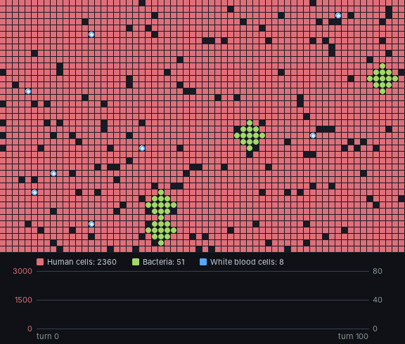
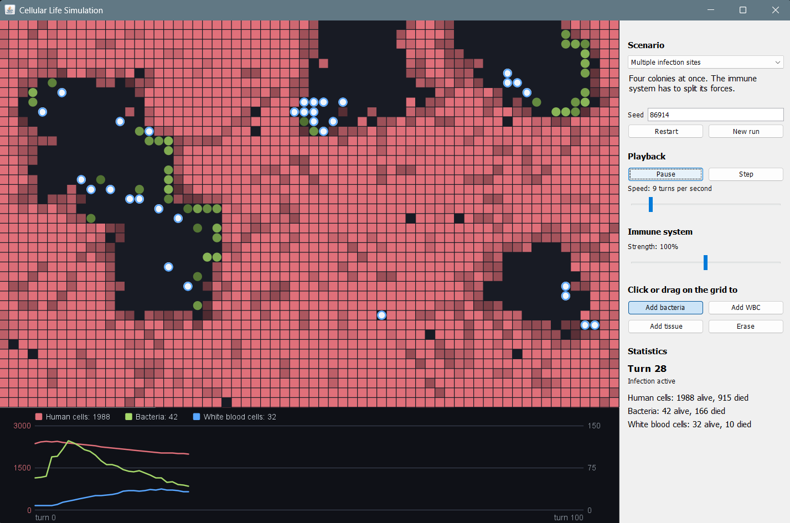

# Cellular Life Simulation

A simulation of an infection in living tissue, inspired by Conway's Game of Life. Bacteria eat their way through human cells, the tissue calls in white blood cells to hunt them down, and whatever survives regrows.

Written in Java with no dependencies beyond the JDK.



## Running it

You need Java 17 or newer.

```bash
javac -d out -sourcepath src src/cellsim/Main.java
java -cp out cellsim.Main
```

This opens the GUI. There is also a text mode for running a scenario in the terminal:

```bash
java -cp out cellsim.Main --list                 # show the scenarios
java -cp out cellsim.Main --cli 4 500 42         # scenario 4, 500 turns, seed 42
```

## The interface



- **Grid.** Human cells are red squares, bacteria are green circles, white blood cells are white circles with a blue ring. The darker a cell, the lower its HP. Hover over a cell to see its age and HP.
- **Painting.** Pick a tool in the sidebar, then click or drag on the grid to add bacteria, white blood cells or tissue, or to erase cells. You can do this while the simulation is running.
- **Immune system slider.** Changes how readily tissue under attack calls in white blood cells. Try lowering it in the middle of an infection.
- **Seed.** A scenario and a seed fully determine a run. *Restart* replays the current run exactly; *New run* picks a new seed.
- **Chart.** Population of each cell type over time. Human cells use the left axis; bacteria and white blood cells share the right one.

## Scenarios

| Scenario | Setup | What usually happens |
|---|---|---|
| Small infection | One colony, normal immune system | Cleared within about 100 turns, with a small wound that heals |
| Multiple infection sites | Four colonies at once | A longer fight and more tissue lost before it is cleared |
| Weak immune system | One colony, slow immune response | The infection spreads faster than it is fought; most of the tissue is lost |
| Severe infection | Three large colonies | A large share of the tissue is destroyed before the immune system wins, then it slowly regrows |
| Healthy tissue | No bacteria | Nothing, until you paint an infection onto the grid |

## How the model works

The tissue is a 64 × 40 grid. Each tile is empty or holds one cell. Every cell has an age, a lifespan and up to 100 HP, and dies when its HP reaches 0 or it outlives its lifespan.

Each turn has two phases.

**1. Interactions.** Every cell's HP changes according to its eight neighbours. All changes are computed from the same snapshot of the grid and applied at once, so the order in which cells are processed doesn't matter. The table gives the HP change one cell causes in one neighbour per turn:

| Source ↓ / Target → | White blood cell | Human cell | Bacteria |
|---|---|---|---|
| **White blood cell** | 0 | 0 | −18 |
| **Human cell** | 0 | 0 | +5 |
| **Bacteria** | −4 | −20 | −1 |

Each effect is scaled by the source cell's *vitality*, a curve over the cell's life that rises from 0.5 at birth to 1.0 at mid-life and falls back to 0.5 in old age. On top of this, human cells regenerate 2 HP per turn and bacteria lose 4 HP per turn, so bacteria starve unless they are feeding on tissue.

**2. Actions.** The surviving cells then act one at a time, in random order:

- **Human cells** divide into an empty neighbouring tile when they are healthy, which is how tissue regrows. A human cell next to bacteria doesn't divide; instead it has a chance to call in a white blood cell, which arrives nearby.
- **Bacteria** split in two when they are mature, well fed and have an empty tile next to them. A bacterium with no tissue in reach crawls towards the nearest human cells.
- **White blood cells** move towards the nearest bacterium they can sense, squeezing past human cells on the way, and stay next to it until it is dead. With nothing to hunt, they wander.

A few white blood cells always patrol the tissue, even when there is no infection.

## Tests

The engine has a small test suite in plain Java, with no test framework to install:

```bash
javac -d out -sourcepath src test/cellsim/SimulationTest.java
java -cp out cellsim.SimulationTest
```

It checks that a seed always replays the same run, that the grid and statistics stay consistent, and that the model behaves as intended: healthy tissue stays healthy, bacteria starve without tissue, an untreated infection destroys the tissue, and a normal immune system clears a small infection. The tests also run on every push through GitHub Actions.

## Project structure

```
src/cellsim/
  Main.java                 entry point
  sim/                      the simulation engine (no UI code)
    Cell.java               abstract base class: age, lifespan, HP, vitality
    HumanCell.java          regenerates, divides, calls for help
    Bacteria.java           feeds, starves, splits, crawls towards tissue
    WhiteBloodCell.java     hunts bacteria
    CellType.java           enum of the three cell types
    Relationships.java      the interaction matrix
    Grid.java               the 2D tissue and neighbourhood queries
    Simulation.java         runs the turns
    Scenario.java           starting setups and the presets
    Statistics.java         population history, births and deaths
  ui/
    Launcher.java           chooses between GUI and text mode
    SimulationPanel.java    the window: grid, chart and sidebar
    GridView.java           draws the grid and handles painting
    PopulationChart.java    the population chart
    Palette.java            colours
    ConsoleRunner.java      text mode
test/cellsim/
  SimulationTest.java       engine tests
```

Each cell type is a subclass of `Cell` that overrides `act()`, so adding a new kind of cell means writing one class and adding a row and column to the interaction matrix.
